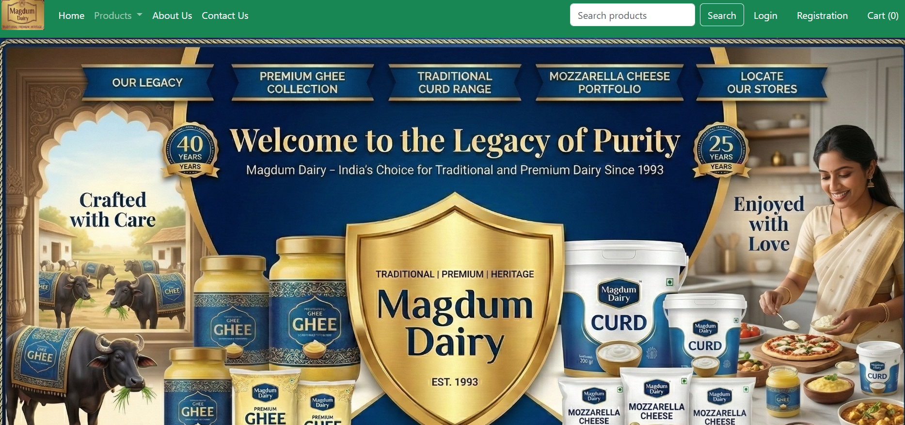
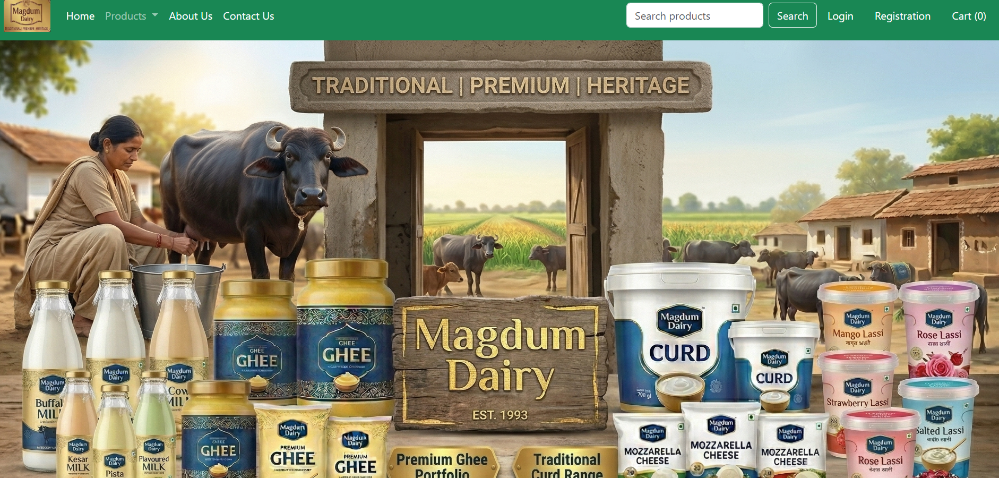
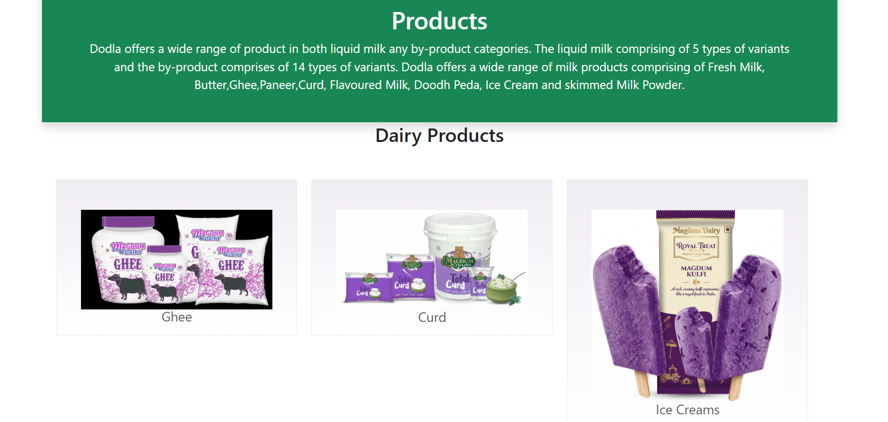

# Magdum Dairy

A Django store for browsing dairy products, managing customer addresses, and placing orders.

## Features

- Product categories, search, and product details
- Customer registration, sign-in, password change, and password reset
- Customer address management
- Authenticated shopping cart with quantity controls
- Checkout, persisted order history, and order-status management in Django admin
- Wishlist management
- Contact form email delivery with saved messages in Django admin

Orders are recorded with a **Pending** status. This project does not currently integrate an online payment provider; payment must be arranged outside the site.

## Run locally

From the `ec` project directory:

##Backend
```powershell
python manage.py runserver
```
##Frontend
```powershell
npm run dev
```
Result :









